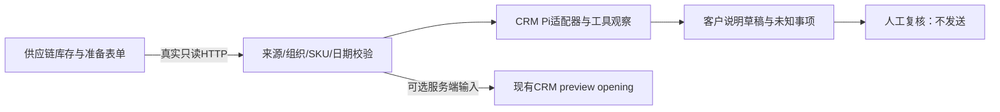

# 基于 AiNativeCrm 的电商客户运营 Agent 二次开发

本仓库保留完整CRM源码，个人改动集中在一个可解释的场景：**客户问“能否发货”，客服如何使用可信运营事实起草说明，并把未知事项交给人核实。**

上游是 [helsome/AiNativeCrm](https://github.com/helsome/AiNativeCrm)，MIT许可证与Rafael Melgaço版权保留。起点是归档 `ddc07c57427105b77c21e6e67a89e986f3913882`；上游已有的中文工作台、多Agent、记忆、知识及审批框架不属于本轮个人新增贡献。[来源与对照方法](UPSTREAM.md) · [本轮改动](MY_CHANGES.md) · [上游完整说明](README.upstream.md)

## 这次具体解决什么

第二项目已能核对库存、补货及准备表单。客服仍不能直接将“库存18件”“采购已确认”“外箱唛有值”变成对客户的发货承诺：资料可能过期，也没有订单预留或真实物流关联。

本轮新增结构化事实校验、只读HTTP适配、真实Pi工具循环与独立复核页面。过期、缺失、商品错配或上游故障会显式降级；生成的草稿始终待人工复核。支持真实模型/Faux多步编排、输出护栏与最多两轮纠错。提案、复核及补偿快照落盘；人工执行合成商机跟进更新，可按版本反向写回撤销；外部回复只核准不发送，没有写入完整CRM。



图中Pi SDK和适配器实际运行，默认使用明确标注的离线Faux脚本；真实引擎可配置OpenAI/DeepSeek兼容API。本轮未验证真实模型质量；独立页面没有启动Supabase或完整CRM发送系统。现有CRM界面尚无本轮资料导入控件，可选接口与独立演示分别说明。


## 快速演示

```sh
# Node>=22，Corepack按packageManager使用pnpm9.15.9
corepack pnpm install --frozen-lockfile
python scripts/portfolio/demo.py start
```

打开 http://127.0.0.1:15273 。实际HTTP场景需要 [供应链项目](https://github.com/fengyue-xve/supply-chain-ops-agent) 的18180服务已启动。缺少它时会报告资料缺失，不伪造数据。停止：`python scripts/portfolio/demo.py stop`。

先按今天检查2026-09-03快照的时效，再切换明确标识的历史回放。页面展示实际HTTP读取、业务基准日、事实缺口、草稿与Pi事件。完整步骤和验证命令见 [运行说明](docs/portfolio/02-run-demo.md)。

最新能力、配置、持久化提案与验证详见 [AI Agent升级说明](docs/portfolio/07-agent-upgrade.md)。顶部“重置演示数据”恢复种子商机，清除旧提案并保留审计。

## 阅读顺序

1. [业务链路](docs/portfolio/01-business-flow.md)：三个项目如何衔接，哪些事实不能越界推导。
2. [本轮代码与贡献](MY_CHANGES.md)：新模块、现有入口接线、上游能力及验收边界。
3. [面试讲解](docs/portfolio/03-interview.md)：只选自己能展开的代码、取舍与验证结果。

核心新代码：`lib/ai/fulfillment/`；Pi演示提供器封装在 `lib/agent-runtime/pi/tool-observation-fixture.ts`；真实CRM可选上下文入口为 `generateReplyDraft → runAgentPreview → appendOperationalEvidence`。

完整平台安装、部署、数据库迁移、RLS与外部服务沿用上游说明。本轮不会把上游历史测试数量或真实模型录制标记为个人新增成果。

界面布局参考与本轮视觉验收见 [界面说明](docs/portfolio/06-interface-design.md)。
