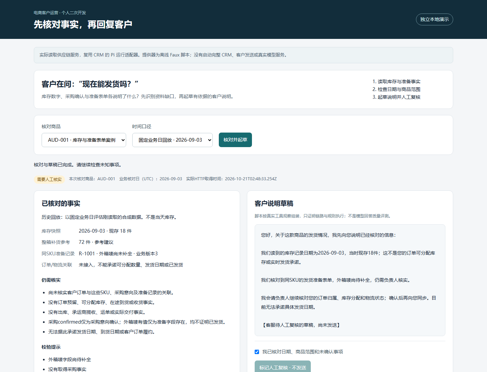
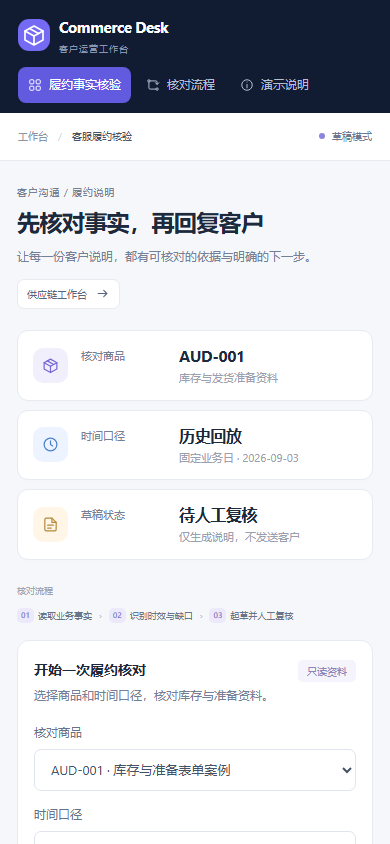

# Commerce CRM Agent

## 1. 项目定位与核心架构

基于 [Pi Native CRM / AiNativeCrm](https://github.com/yftx293/AiNativeCrm) 的全量源码底座，保留完整 CRM 工作台、上游 MIT 许可证与原始版权声明，并扩展履约 Agent。个人扩展围绕供应链只读事实、证据时效、Pi 工具调用、回复草稿和人工复核，核心实现见 [`CORE_MODULES.md`](CORE_MODULES.md)。

~~~mermaid
flowchart LR
  S[供应链只读事实] --> E[Evidence Zod + Freshness]
  Q[买家问题] --> P[Pi Agent]
  E --> P
  P --> G[Output Guardrail]
  G --> C[Self-Correction]
  C --> D[安全回复草稿]
  P --> PS[Durable ProposalStore]
  PS --> H[人工审批 / Execute / Undo]
  H --> AU[审计记录]
~~~

## 2. 核心 AI Agent 与受控工程特性

- Pi 运行时同时支持 Faux 离线提供器与 OpenAI/DeepSeek 兼容 API，多步调用库存、补货参考和发货准备表单工具。
- 输入侧使用 Zod 做组织与 SKU 范围校验，库存快照保留 UTC 7 天时效和部分失败缺口。
- 输出侧核对库存数值、单位和发货承诺。校验未通过时最多请求模型改写两轮，再生成确定性复核草稿。模型超时、调用失败或库存服务不可用时显示对应原因，保留买家问题供重试。
- 履约 Agent 的读工具读取事实，写入和外发工具仅生成提案。人工确认后可修改演示商机阶段或标签，可按业务版本补偿撤销。外发提案保留 `canSend=false`，人工批准用于记录审核结果。
- 独立演示的 `ProposalStore` 在本机 JSON 文件中保存草稿、提案和审计，用文件锁、原子替换和版本检查保持一致性。全量 CRM 底座通过 PostgreSQL、组织范围和 RLS 管理租户数据。
- `evidence.ts`、`supply-chain-reader.ts` 和 `draft.ts` 构建履约事实与草稿。`operational-opening.ts` 向全量 CRM 的可选路径注入核验结果。`output-guardrail.ts` 校验草稿，`proposal-store.ts` 在 Agent 循环之外处理人工决策。
- `portfolio:test` 运行履约、事实桥、知识库提示和 Pi 运行时测试。浏览器、跨进程持久化和真实模型 smoke 由独立脚本验证；[回归清单](docs/eval/crm-regression-manifest.md)列出各命令和覆盖范围。

## 3. 工作台界面截图

## 4. 核心源码导航

| 模块 | 位置 |
| --- | --- |
| 履约 Agent | [lib/ai/fulfillment/agent.ts](lib/ai/fulfillment/agent.ts) |
| Agent 配置 | [lib/ai/fulfillment/agent-config.ts](lib/ai/fulfillment/agent-config.ts) |
| Evidence 护栏 | [lib/ai/fulfillment/evidence.ts](lib/ai/fulfillment/evidence.ts) |
| Supply Chain Reader | [lib/ai/fulfillment/supply-chain-reader.ts](lib/ai/fulfillment/supply-chain-reader.ts) |
| Deterministic Draft | [lib/ai/fulfillment/draft.ts](lib/ai/fulfillment/draft.ts) |
| 输出护栏 | [lib/ai/fulfillment/output-guardrail.ts](lib/ai/fulfillment/output-guardrail.ts) |
| 提案持久化 | [lib/ai/fulfillment/proposal-store.ts](lib/ai/fulfillment/proposal-store.ts) |
| Context bridge | [lib/agent-engine/agent/operational-opening.ts](lib/agent-engine/agent/operational-opening.ts) |
| Tool Observation | [lib/agent-runtime/pi/tool-observation-fixture.ts](lib/agent-runtime/pi/tool-observation-fixture.ts) |
| 演示服务 | [scripts/portfolio/server.mts](scripts/portfolio/server.mts) |
| 浏览器 smoke | [scripts/portfolio/browser-smoke.mjs](scripts/portfolio/browser-smoke.mjs) |

## 5. 本地快速启动与自动化验证

准备 Node.js 22+ 和仓库锁定的 pnpm 9.15.9。先启动 [`config.example.json`](examples/fulfillment-demo/config.example.json) 指向的供应链合成环境，默认地址为 `http://127.0.0.1:18180`。

~~~powershell
corepack pnpm install --frozen-lockfile
corepack pnpm portfolio:demo
~~~

打开 [履约工作台](http://127.0.0.1:15273)。`portfolio:demo` 使用 Faux 脚本模型，库存和补货仍从供应链服务读取。若要后台启动，可用 `python scripts/portfolio/demo.py start`，停止时使用 `stop`。

真实模型入口为 `corepack pnpm portfolio:live`。设置 `PORTFOLIO_LLM_ENGINE`（`openai`、`deepseek` 或 `openai-compatible`）和 `PORTFOLIO_LLM_API_KEY`。使用 `openai-compatible` 时还要设置 `PORTFOLIO_LLM_BASE_URL`，可用 `PORTFOLIO_LLM_MODEL` 指定模型。运行前核对 `http://127.0.0.1:15273/api/health` 的 `mode` 与 `provider`。

~~~powershell
corepack pnpm portfolio:typecheck
corepack pnpm portfolio:test
~~~

跨进程脚本和 Playwright 准备事项见[回归清单](docs/eval/crm-regression-manifest.md)。
