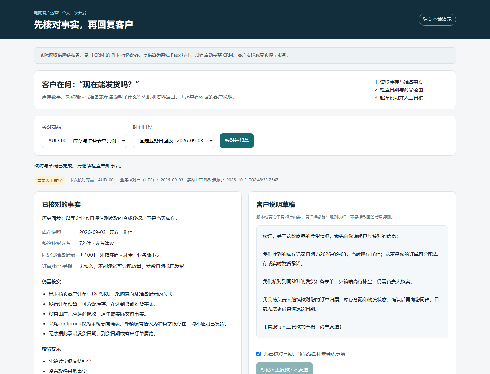
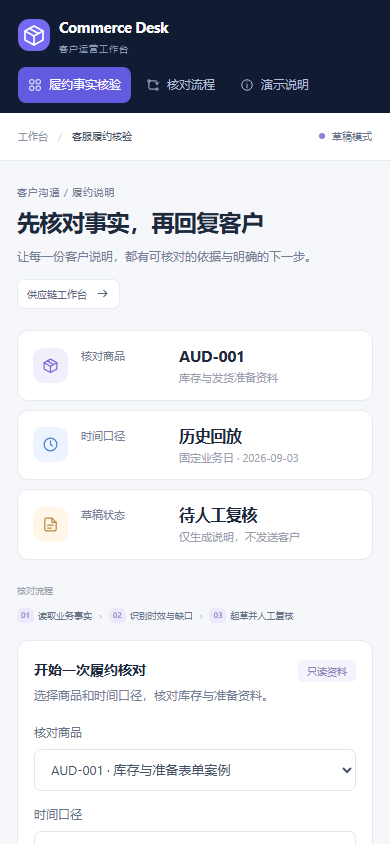

# Commerce CRM Agent

## 1. 项目定位与核心架构

自托管、多租户、Agent 原生的电商运营 CRM 平台。系统把供应链只读事实、买家问题、履约核验、客户跟进和人工提案串成闭环。

~~~mermaid
flowchart LR
  S[供应链只读事实] --> E[Evidence Zod + Freshness]
  Q[买家问题] --> P[Pi Agent]
  E --> P
  P --> G[Output Guardrail]
  G --> C[Self-Correction]
  C --> D[安全回复草稿]
  P --> PS[Durable ProposalStore]
  PS --> H[人工审批 / Execute / Undo]
  H --> AU[Audit]
~~~

## 2. 核心 AI Agent 与受控工程特性

- Pi 运行时同时支持 Faux 离线提供器与 OpenAI/DeepSeek 兼容 API，多步调用库存、补货参考和发货准备表单工具。
- 输入侧使用 Zod 做组织与 SKU 范围校验，库存快照保留 UTC 7 天时效和部分失败缺口。
- 输出侧核对库存数值、单位和发货承诺；违规原因反馈给模型，最多执行 2 轮 Self-Correction，失败时返回确定性安全草稿。
- 工具分为 read、reversible_write、external、irreversible 四级。可逆写记录版本快照并支持 Compensation Undo；external 动作生成 canSend=false 的待批准提案。
- ProposalStore 使用文件锁、fsync、原子替换和 generation 版本持久化提案与审计记录，多租户数据通过 PostgreSQL Schema/RLS 隔离。

## 3. 工作台界面截图

## 4. 核心源码导航

| 模块 | 位置 |
| --- | --- |
| 履约 Agent | [lib/ai/fulfillment/agent.ts](lib/ai/fulfillment/agent.ts) |
| Agent 配置 | [lib/ai/fulfillment/agent-config.ts](lib/ai/fulfillment/agent-config.ts) |
| Evidence 护栏 | [lib/ai/fulfillment/evidence.ts](lib/ai/fulfillment/evidence.ts) |
| 输出护栏 | [lib/ai/fulfillment/output-guardrail.ts](lib/ai/fulfillment/output-guardrail.ts) |
| 提案持久化 | [lib/ai/fulfillment/proposal-store.ts](lib/ai/fulfillment/proposal-store.ts) |
| Tool Observation | [lib/agent-runtime/pi/tool-observation-fixture.ts](lib/agent-runtime/pi/tool-observation-fixture.ts) |
| 演示服务 | [scripts/portfolio/server.mts](scripts/portfolio/server.mts) |
| 浏览器 smoke | [scripts/portfolio/browser-smoke.mjs](scripts/portfolio/browser-smoke.mjs) |

## 5. 本地快速启动与自动化验证

~~~powershell
corepack pnpm install --frozen-lockfile
python scripts/portfolio/demo.py start
pnpm portfolio:typecheck
pnpm portfolio:test
node scripts/portfolio/browser-smoke.mjs
node scripts/portfolio/persistence-smoke.mjs
~~~

真实模型模式配置 OPENAI_API_KEY、OPENAI_BASE_URL、OPENAI_MODEL 或对应的 DeepSeek 兼容变量。
